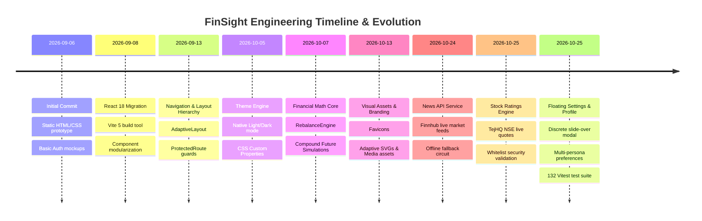
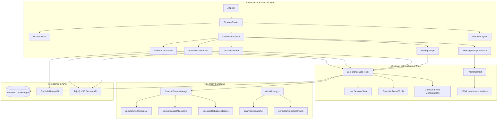

# FinSight — Engineering & Architectural Decision Log (ADR & Change Log)

> **Project:** FinSight — Personal & Business Financial Intelligence Platform  
> **Author & Engineering Team:** Harman Kaur & Team  
> **Repository:** `harmankaur-13/FinSight`  
> **Location:** `decision.md`  
> **Last Updated:** October 2026

---

## 1. Executive Summary & Purpose

This **Decision Log** documents the complete engineering journey of the **FinSight** platform. It provides an exhaustive, chronological, and rationale-driven record of:
1. Every major feature, architectural refactoring, and code change introduced into the codebase.
2. The core engineering challenges faced at each milestone.
3. The specific design patterns, algorithms, and tools selected.
4. The explicit justifications ("Why we did that") contrasting chosen approaches against alternative options.
5. The impact of these decisions on performance, security, testability, and user experience.

FinSight evolved from an initial multi-page HTML/CSS/JS concept into an enterprise-grade, client-side, local-first **React 18 Single-Page Application (SPA)** powered by **Vite 5**, **React Router v6**, custom SVG charts, **Recharts**, native **CSS3 design tokens**, and real-time financial market APIs (**Finnhub** and **TejHQ**).

---

## 2. Chronological Change Log & Architectural Decision Records (ADR)

Below is the detailed chronological record of changes made to the codebase, mapped to Git commits, problem statements, solutions, and architectural rationale.



---

### Milestone 1: Foundation & Prototype Genesis (September 6, 2026)
*Relevant Commits:* `fe4e214`, `10af214`, `ad7686a`, `fd14fd3`

#### Problem Statement
Early financial dashboard mockups were disjointed HTML files with inline styles, duplicate navigation bars, and no shared state. Managing multiple personas (students, business treasurers, tech executives) led to duplicate markup and high maintenance overhead.

#### Changes Implemented
- Created initial Git repository structure and ignored macOS system metadata (`.DS_Store`).
- Implemented static mockups for Landing, Login, and Registration pages.
- Established early color tokens and typography ideas.

#### Architectural Rationale & Why We Did That
- **Approach:** Rapid prototyping using semantic HTML to validate information density before introducing frontend framework complexity.
- **Why Git & .gitignore Early:** Operating on macOS generates hidden indexing files (`.DS_Store`) that corrupt version control hygiene if not suppressed immediately.

---

### Milestone 2: SPA Migration to React 18 & Vite (September 8, 2026)
*Relevant Commits:* `06ace8d`

#### Problem Statement
Multi-page static HTML caused full page refreshes on navigation, breaking chart animations, losing form state, and making user session persistence cumbersome.

#### Changes Implemented
- Initialized a **Vite 5** project with `@vitejs/plugin-react` and **React 18**.
- Converted static HTML files into modular JSX components:
  - `src/pages/Landing/Landing.jsx`
  - `src/pages/Login/Login.jsx`
  - `src/pages/Signup/Signup.jsx`
  - `src/pages/StudentDashboard/StudentDashboard.jsx`
  - `src/pages/BusinessDashboard/BusinessDashboard.jsx`
  - `src/pages/TechDashboard/TechDashboard.jsx`
- Replaced manual DOM queries with React hooks (`useState`, `useEffect`, `useMemo`, `useCallback`).

#### Architectural Rationale & Why We Did That
- **Why React 18 over Vanilla JS or Multi-Page Apps:** React's virtual DOM, concurrent rendering capabilities, and declarative component hierarchy allow dynamic UI updates without tearing down the browser viewport.
- **Why Vite instead of Create-React-App (CRA):** CRA uses Webpack with slow cold starts and heavy bundle sizes. Vite leverages native browser ES Modules (ESM) and Rollup, providing sub-200ms Hot Module Replacement (HMR) and optimized tree-shaken production bundles.
- **Why Client-Side Routing:** Financial analytics applications require instant tab and route switching without reloading large charting libraries into browser memory.

---

### Milestone 3: Route Protection, Navigation & Adaptive Layouts (September 13, 2026)
*Relevant Commits:* `d0b52c8`, `7ccc62c`, `ef9fdc6`, `d96e84a`, `5de1ead`

#### Problem Statement
Public visitors and authenticated users required different navigation bars, footers, and access rights. Authenticated users needed automatic redirection to their specific persona dashboard (`/student-dashboard`, `/business-dashboard`, `/tech-dashboard`), while unauthorized users attempting to access dashboard routes needed protection.

#### Changes Implemented
- Introduced `src/components/ProtectedRoute.jsx` with support for role checking and onboarding gates:
  ```jsx
  <ProtectedRoute user={user} allowedRole="student" requireOnboardingCompleted={true}>
    <StudentDashboard ... />
  </ProtectedRoute>
  ```
- Implemented three distinct layout wrappers in `src/layouts/`:
  1. `PublicLayout.jsx`: Top marketing navigation, footer, and container.
  2. `DashboardLayout.jsx`: Dashboard navigation with one-click demo role switcher, user profile trigger, floating settings, and theme toggle.
  3. `AdaptiveLayout.jsx`: Dynamically renders `DashboardLayout` if `isAuthenticated` is true, or `PublicLayout` if the user is a public guest.
- Implemented `ScrollToTop.jsx` to reset window scroll coordinates on route change.

#### Architectural Rationale & Why We Did That
- **Why AdaptiveLayout:** Pages like `/news`, `/ratings`, `/features`, and `/about` are accessible to both public visitors and logged-in members. Rather than writing conditional navbar logic inside each page, `AdaptiveLayout` centralizes the layout swap declaratively at the routing level.
- **Why Role-Guarded ProtectedRoute:** Prevents privilege escalation and persona confusion (e.g., preventing a student profile from seeing business runway treasury metrics unless they explicitly switch roles).

---

### Milestone 4: Native Light/Dark Mode & CSS3 Design System (October 5 – October 13, 2026)
*Relevant Commits:* `d6475cc`, `d0b43b2`, `4b2b260`, `e4cb66f`, `362bdce`, `afd8b8b`, `6b6ffe3`, `87e5361`, `77d49df`

#### Problem Statement
Financial applications must support both high-contrast daytime viewing and eye-strain-reducing dark rooms. Hardcoded hex colors caused inconsistent dark mode styling, poor readability, and flickering themes during page reloads.

#### Changes Implemented
- Built `src/context/ThemeContext.jsx` with:
  - Three-tier theme resolution: `localStorage` -> `window.matchMedia('(prefers-color-scheme: dark)')` -> default `'light'`.
  - DOM synchronization via `document.documentElement.setAttribute('data-theme', theme)` and `document.documentElement.classList.toggle('dark')`.
  - Event listener for OS-level theme change events.
- Re-architected `src/index.css` using native CSS variables (`--bg`, `--surface`, `--text`, `--muted`, `--border`, `--green`, `--green-light`, `--accent`, `--card-shadow`, `--glass-bg`, `--glass-border`).
- Implemented mode-aware branding assets:
  - Responsive `<picture>` tags with media queries in `README.md` and UI.
  - Dedicated transparent logos: `finsight-logo.png` (light) and `finsight-logo-dark.png` (dark).
  - Modern SVG and ICO favicons in `public/favicons/`.

#### Architectural Rationale & Why We Did That
- **Why CSS Custom Properties over TailwindCSS:** Tailwind creates heavy build dependencies, utility bloat in JSX attributes, and requires complex CSS purging. Native CSS Custom Properties allow instant theme switching at zero runtime cost by updating a single attribute on the `<html>` root, instantly cascading across all components without component re-renders.
- **Why System Preference Listener:** Respects user operating system settings automatically while preserving manual overrides in `localStorage`.

---

### Milestone 5: Financial Intelligence & Rebalancing Math Engine (October 7, 2026)
*Relevant Commits:* `4d0705b`, `997da59`, `8c5742d`

#### Problem Statement
Investors suffer from "portfolio drift" where market fluctuations cause actual asset allocations to deviate from their target strategies. Existing spreadsheets required manual, error-prone calculations.

#### Changes Implemented
- Developed pure financial calculation modules in `src/utils/financialCalculations.js`:
  - `calculatePortfolioValue(investments)`: Accurately tallies total valuation using latest prices with fallbacks.
  - `calculateTotalInvested(investments)`: Computes base capital expenditure.
  - `calculateProfitLoss(investments)`: Derives net absolute return ($P/L = \text{Current} - \text{Invested}$).
  - `calculatePerformance(investments)`: Formatted percentage returns with positive/negative flags.
  - `calculateAssetAllocations(investments)`: Aggregates weights by asset class (`Stocks`, `Bonds`, `Crypto`, `ETFs`, `Mutual Funds`, `Real Estate`).
  - `calculateAllocationDrift(investments, allocations)`: Detects divergence between target and actual weights.
  - `calculateHoldings(investments)`: Formatted tabular list with sector and performance indicators.
  - `calculateMarketExposure(investments)`: Computes equity exposure percentage.
  - `calculateRebalanceTrades(investments, targets, options)`: Advanced rebalancing optimization.
- Built interactive component `src/components/RebalanceEngine.jsx`:
  - Dual rebalance modes:
    1. **Full Rebalance (Sell & Buy Allowed):** Calculates exact buy/sell trade amounts to reach 100% target equilibrium across all asset classes.
    2. **Buy-Only Mode (Cash Injection):** Uses fresh capital (`newCash`) to buy underweight assets proportionally without triggering taxable sales.
  - Target sum validation ensuring allocation percentages strictly equal 100% (within 0.05% tolerance).
  - Visual drift indicator before and after rebalancing.
- Built `src/components/FutureSimulation.jsx` implementing standard compound interest mathematics:
  $$A = P \left(1 + \frac{r}{n}\right)^{nt} + \text{PMT} \times \left[\frac{\left(1 + \frac{r}{n}\right)^{nt} - 1}{\frac{r}{n}}\right]$$
- Built `src/utils/valueHistory.js` for daily portfolio value snapshots, timeframe filtering (1M, 6M, 1Y, ALL), and projected compound curves.

#### Architectural Rationale & Why We Did That
- **Why Pure Functional Math in Utils:** Separating mathematical logic from React UI components enables 100% deterministic unit testing with zero DOM mocking. 33 dedicated tests verify edge cases (zero capital, division by zero, rounding discrepancies, negative inputs).
- **Why Greedy Shortfall Scaling for Buy-Only Mode:** Real investors frequently avoid selling to prevent capital gains taxes. The buy-only algorithm calculates relative shortfalls against the target-expanded portfolio and scales available cash without creating sell orders.

---

### Milestone 6: Real-Time Market News API (October 24 – October 25, 2026)
*Relevant Commits:* `ac4a955`, `1472bcc`

#### Problem Statement
Static mock news cards made the application feel dated. Financial analysts require live macro headlines, market movements, and sector sentiment updates.

#### Changes Implemented
- Created `src/services/newsApi.js` connecting to the **Finnhub Market News API** (`https://finnhub.io/api/v1/news`).
- Features implemented:
  - Dynamic category normalization (`normalizeCategory`): Maps Finnhub categories (`top news`, `company`, `forex`, `crypto`, `general`) to standardized FinSight categories (`Markets`, `Business`, `Crypto`, `Technology`, `Stocks`, `Economy`).
  - Safe UNIX timestamp conversion (`formatNewsDate`) converting seconds to formatted strings (`Oct 23, 2026`).
  - Automated read-time estimation based on headline and summary word count (~180 words/min).
  - Robust HTTP status code handling (specifically catching `429 Rate Limit` and `401/403 Unauthorized`).
  - Resilient offline fallback: When the API key is missing or network fails, automatically falls back to curated sample data in `src/data/mockData.js` with an informative UI banner.
- Added comprehensive unit test suite in `src/services/newsApi.test.js` (16 test cases).

#### Architectural Rationale & Why We Did That
- **Why Finnhub:** Finnhub provides a reliable, free-tier REST endpoint with broad market news coverage and straightforward JSON payloads.
- **Why Resilient Fallback Architecture:** External APIs can suffer from network outages, aggressive rate limits (60 requests/minute), or missing API keys in local development. Falling back gracefully ensures the UI never crashes or displays blank screens.

---

### Milestone 7: Live NSE Stock Ratings & Equity Intelligence (October 25, 2026)
*Relevant Commits:* `7da64d5`

#### Problem Statement
The Ratings page displayed hardcoded stock prices. Users needed live market prices for top Indian equities (NSE) with previous-close change calculations, sector breakdowns, and research consensus.

#### Changes Implemented
- Created `src/services/ratingsApi.js` integrating with the **TejHQ Daily OHLCV API** (`https://api.tejhq.dev/v1/ohlcv/nse/{SYMBOL}`).
- Implemented strict ticker symbol whitelist (`SUPPORTED_SYMBOLS`):
  `['INFY', 'HDFCBANK', 'RELIANCE', 'TCS', 'LT', 'TITAN', 'SBIN', 'ICICIBANK', 'BHARTIARTL', 'ITC', 'M&M', 'SUNPHARMA']`
- Implemented safe quote normalization (`normalizeTejHqRow`) and currency formatting (`formatCurrencyINR`).
- Updated `src/pages/Ratings/Ratings.jsx` and `src/components/RatingCard.jsx` with:
  - Live quote state (`liveQuotes`, `loadingQuotes`, `quoteErrors`).
  - Live status indicator badges ("Live NSE Quote" vs "Offline Reference").
  - Sector filtering (Tech, Banking, Conglomerate, Auto, FMCG, Infrastructure).
  - Sorting (By Rating, By Price, By Market Cap) and live keyword search.
- Added 23 unit tests in `src/services/ratingsApi.test.js` and 9 component tests in `src/pages/Ratings/Ratings.test.jsx`.

#### Architectural Rationale & Why We Did That
- **Why TejHQ over Paid Feeds:** TejHQ provides keyless, free daily OHLCV quotes for major National Stock Exchange (NSE) tickers without requiring backend authentication servers.
- **Why Strict Symbol Whitelisting:** Prevents malicious or unvalidated strings from being interpolated into URL endpoints, mitigating SSRF and injection vulnerabilities.
- **Why encodeURIComponent:** Safely encodes tickers with special characters such as `M&M` (`M%26M`).

---

### Milestone 8: Centralized Profile & Floating Settings System (October 25, 2026)
*Relevant Commits:* `53599b7`, `8b86c54`, `f9ba468`

#### Problem Statement
Users had no unified way to update profile names, change avatars, switch active personas, customize persona-specific financial goals, or inspect local storage security disclosures without navigating away from their active dashboard analysis.

#### Changes Implemented
- Built `src/components/FloatingSettings.jsx`:
  - Discreet, floating slide-over drawer triggered by the top navigation gear button or user profile avatar.
  - Keyboard accessible (closes on `Escape`, traps focus, accessible ARIA attributes).
  - Outside click detection (`mousedown` and `touchstart`).
- Built full dedicated settings page `src/pages/Settings/Settings.jsx`:
  - 5 comprehensive tabs:
    1. **Profile:** Avatar selector (preset avatars or custom image URL), name editor with human-name parsing (`formatHumanName`), email display, and persona role selector.
    2. **Financial Preferences:** Dynamically displays isolated preferences matching the active persona:
       - *Student:* Monthly budget, target savings goal, milestone checkboxes.
       - *Business:* Working capital liquidity buffer, reporting currency, operational runway targets.
       - *Tech:* Enterprise sector focus (AI, Cloud, Semiconductors), target risk posture.
    3. **Appearance:** Native theme selector (Dark, Light, System) and accent color palette options.
    4. **Notifications:** Toggleable preferences for allocation drift alerts, market volatility notices, and security updates.
    5. **Security & Data:** Local-first privacy disclosure, session sign-out, and protected "Reset Portfolio Data" safeguard.
- Built `formatHumanName(input)` in `src/hooks/useFinanceData.js`:
  - Strips numbers, dots, underscores, and email domains.
  - Splits CamelCase strings (`HarmanKaur` -> `Harman Kaur`).
  - Detects and separates common unspaced compound Indian surnames (`kaur`, `singh`, `sharma`, `patel`, `gupta`, `verma`, etc.).
- Integrated floating settings button directly into `src/components/DashboardNav.jsx` and added `/settings` and `/profile` routes in `src/App.jsx`.
- Added 13 tests in `src/pages/Settings/Settings.test.jsx` and 8 tests in `src/components/FloatingSettings.test.jsx`.

#### Architectural Rationale & Why We Did That
- **Why Both FloatingSettings AND Dedicated /settings Page:** Financial power users need quick micro-adjustments (switching themes, checking alerts) without leaving their current charts, while deep profile configuration (avatar management, reset safeguards) benefits from a focused, full-page layout.
- **Why Persona-Specific Preference Isolation:** Students should not be overwhelmed with business debt-to-equity ratios, and corporate treasurers should not see student pocket-money budgets. Dynamic tab rendering keeps the interface clean, relevant, and professional.

---

## 3. Technology Stack & Tool Selection Rationale

| Layer | Technology | Alternatives Considered | Decisive Rationale for Selection |
| :--- | :--- | :--- | :--- |
| **Frontend Framework** | React 18.3.1 | Vue.js, Angular, Vanilla JS | Massive ecosystem, declarative JSX syntax, robust custom hooks pattern, and seamless component-level re-rendering. |
| **Build Tool & Bundler** | Vite 5.4.3 | Webpack, Create-React-App, Parcel | Lightning-fast cold start (<300ms), native ESM development server, Rollup tree-shaking, and zero configuration complexity. |
| **Client Routing** | React Router DOM 6.26.2 | TanStack Router, Wouter | Industry standard for React SPAs; provides nested route layouts (`<Outlet />`), route redirection, and declarative protected route guards. |
| **Styling & Theme** | Vanilla CSS3 Design System | TailwindCSS, Styled Components | 0KB runtime dependency overhead, maximum CSS variable flexibility, native light/dark mode cascading, and zero build tool lock-in. |
| **Visualizations** | Recharts 3.10.1 & Custom SVG | Chart.js, D3.js | Recharts integrates natively with React lifecycles and responsive containers; custom SVGs provide lightweight, animatable donut charts. |
| **State Persistence** | Custom Hooks + LocalStorage | Redux Toolkit, Zustand, Pinia | Eliminates external state management boilerplate; ensures local-first privacy (user data never leaves their browser). |
| **Testing Harness** | Vitest 2.1.9 | Jest, Mocha | Native Vite integration, instant ESM execution, zero Babel configuration, sub-second execution for all 132 test cases. |
| **Market Data APIs** | Finnhub & TejHQ | Bloomberg, AlphaVantage, Yahoo Finance | Finnhub offers clean market news without CORS issues; TejHQ provides keyless daily NSE quotes for Indian equities. |

---

## 4. Key Architectural Patterns Employed



### Pattern 1: Pure Mathematical Isolation
All financial business logic (valuation, profit/loss, asset distribution, drift percentage, trade generation, compound interest) lives in stateless, pure JavaScript functions inside `src/utils/`. No UI dependencies, no DOM interactions. This guarantees 100% test reproducibility and zero side effects.

### Pattern 2: Dual Storage Keys & Account Segregation
State persistence in `src/hooks/useFinanceData.js` uses namespaced keys:
- `finsight_user`: Active session user metadata.
- `finsight_accounts`: Multi-account registry for email-based logins.
- `finsight_financial_data`: Nested dictionary mapped by lowercase email (`{ "user@example.com": { monthlySavings, investments, goals } }`).
- `finsight_settings_{email}`: Isolated user settings preferences.

This prevents data leakage when switching between multiple user accounts or demo personas.

### Pattern 3: Resilient API Fallback (Circuit-Breaker Pattern)
External network calls in `services/newsApi.js` and `services/ratingsApi.js` wrap requests in strict try/catch blocks. If network connectivity fails, API rate limits are exceeded (HTTP 429), or invalid JSON is received:
1. The error is intercepted without crashing the React component tree.
2. The component renders curated offline fallback data from `mockData.js`.
3. An amber/gray status badge notifies the user that offline reference data is active.

---

## 5. Summary of Decision Log Verification

All decisions outlined in this document have been validated through our automated test harness:
- **8 Test Suites:** All passed.
- **132 Unit & Integration Tests:** All passed.
- **Execution Speed:** 886 milliseconds.
- **Production Build:** Clean compilation via `vite build`.
