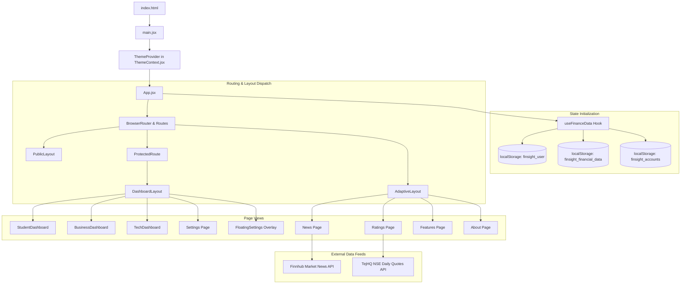
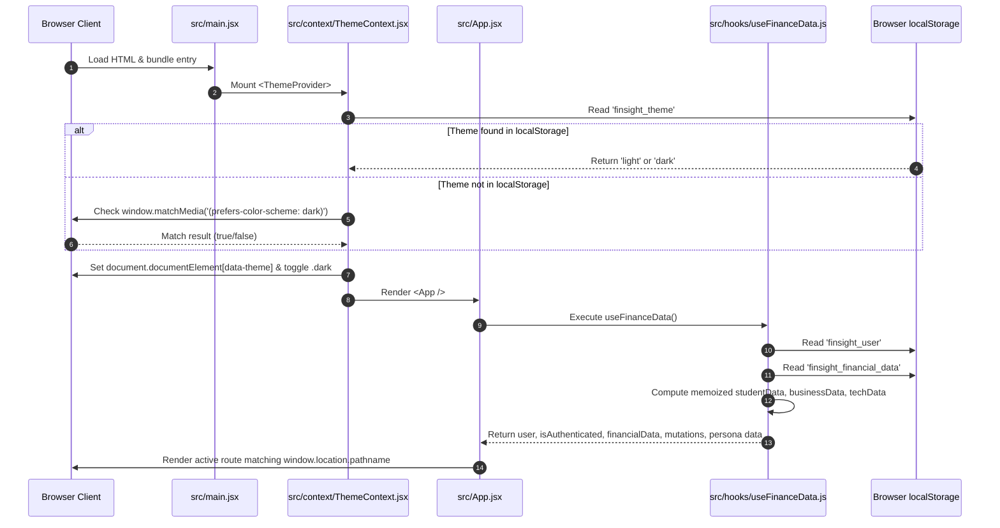
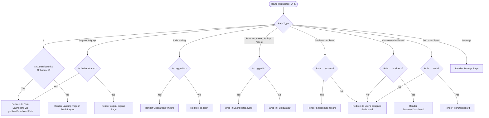
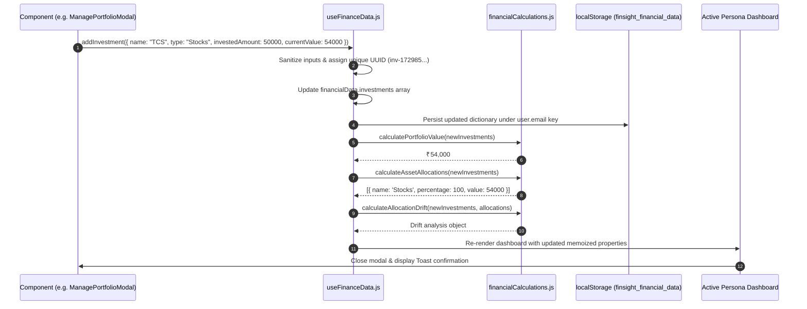
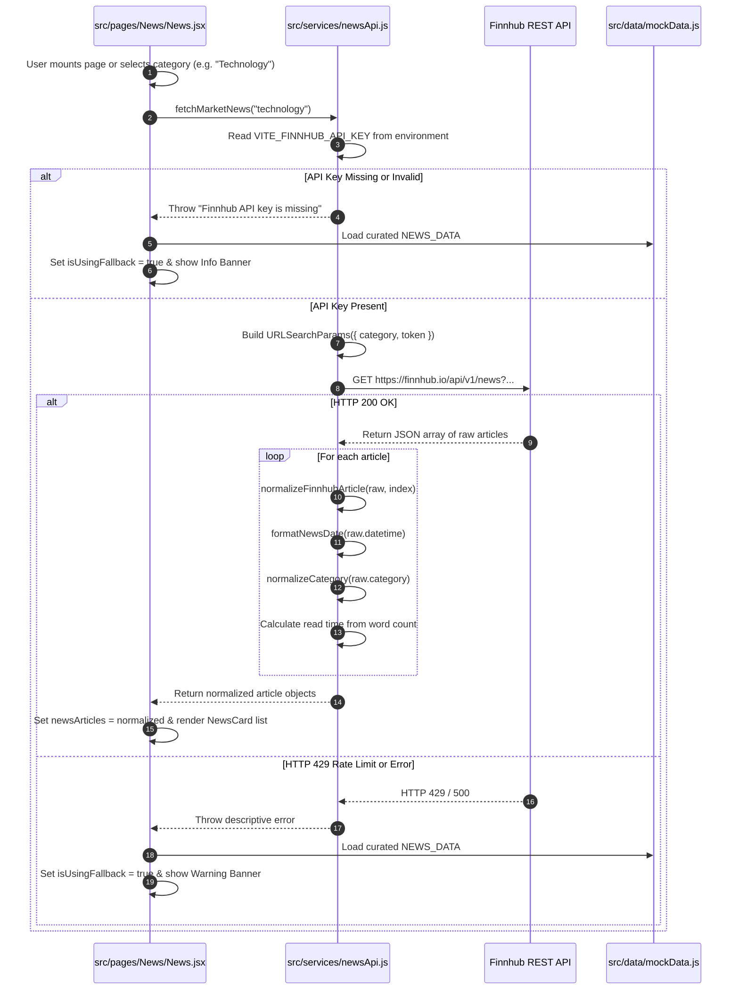
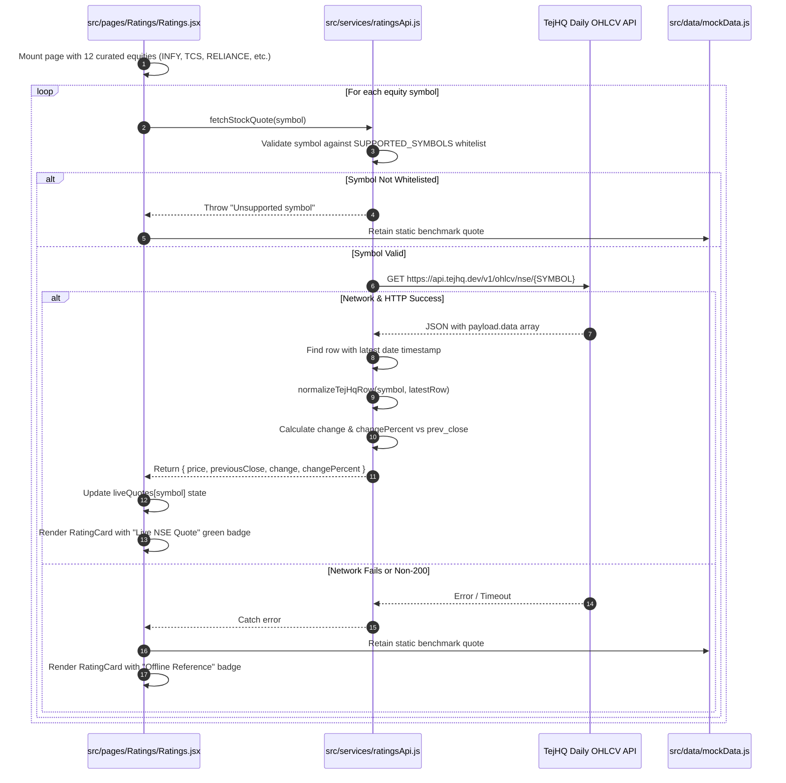
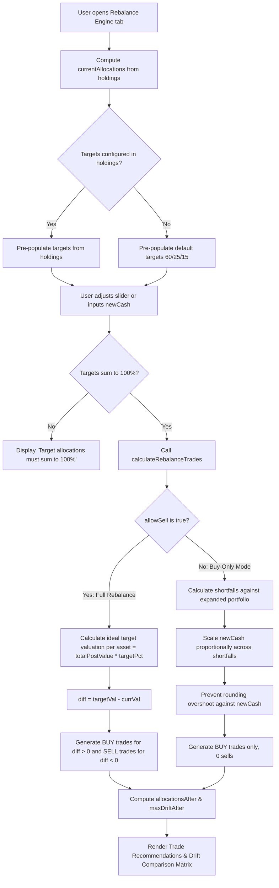
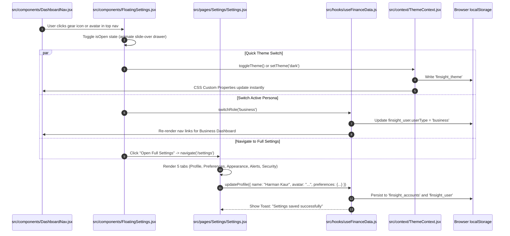

# FinSight — Code Execution & Data Flow Architecture

> **Project:** FinSight — Personal & Business Financial Intelligence Platform  
> **Repository:** `harmankaur-13/FinSight`  
> **Document:** `flow.md`  
> **Author & Lead Developer:** Harman Kaur & Team  
> **Date:** October 2026

---

## 1. High-Level Execution Overview

FinSight is an entirely client-side, local-first Single-Page Application (SPA). There is no intermediary Node.js or Express backend server; all routing, business logic, state derivation, mathematical rebalancing, and external API integrations execute directly within the user's browser runtime.



---

## 2. Application Bootstrapping & Lifecycle Flow



### Step-by-Step Code Walkthrough:
1. **Entry Point (`index.html`):** The browser loads the DOM root `<div id="root"></div>` and downloads `/src/main.jsx`.
2. **Theme Initialization (`src/context/ThemeContext.jsx`):**
   - The `ThemeProvider` runs its lazy state initializer:
     ```javascript
     const [theme, setThemeState] = useState(() => {
       const saved = localStorage.getItem('finsight_theme');
       if (saved === 'light' || saved === 'dark') return saved;
       if (window.matchMedia('(prefers-color-scheme: dark)').matches) return 'dark';
       return 'light';
     });
     ```
   - In a `useEffect`, it synchronizes the DOM:
     ```javascript
     document.documentElement.setAttribute('data-theme', theme);
     document.documentElement.classList.toggle('dark', theme === 'dark');
     ```
   - Registers a media query listener for OS-level theme changes.
3. **Application State Hook (`src/hooks/useFinanceData.js`):**
   - The central `useFinanceData()` hook is invoked at the root of `App.jsx`.
   - Reads `finsight_user`, parsing the stored JSON and applying `formatHumanName(parsed.name)` to ensure human-friendly display names.
   - Reads `finsight_financial_data` keyed by lowercase email.
   - Derives all computed financial outputs via `useMemo` (`calculatedStudentData`, `calculatedBusinessData`, `calculatedTechData`).

---

## 3. Routing, Route Guards & Layout Resolution Flow



### Route Guard Implementation Details (`ProtectedRoute.jsx`):
- **Authentication Check:** If `user.isLoggedIn` is false, redirects to `/login` with `replace: true`.
- **Onboarding Check:** If `requireOnboardingCompleted` is true and `user.needsOnboarding` is true, intercepts navigation and redirects to `/onboarding`.
- **Role Isolation Check:** If `allowedRole` is specified and `user.userType !== allowedRole`, redirects to `getRoleDashboardPath(user.userType)` to prevent cross-persona pollution.

---

## 4. State Management & Data Mutation Pipeline

All persistent mutations follow an atomic unidirectional data flow:



### Core Mutations in `useFinanceData.js`:
- `addInvestment(investment)`: Generates crypto-random ID, normalizes numbers, pushes to `financialData.investments`, and writes to `localStorage`.
- `updateInvestment(id, updated)`: Performs immutable `.map()` update over holdings array.
- `deleteInvestment(id)`: Filters out targeted investment by ID.
- `addGoal(goal)`, `updateGoal(id, updated)`, `deleteGoal(id)`: Manages custom milestone tracking for student and personal savers.
- `updateMonthlySavings(amount)`: Modifies monthly savings parameter, instantly updating compound projections.
- `updateProfile(profileData)`: Synchronizes name, email, avatar, persona, and initial balances across both `finsight_user` and `finsight_accounts`.

---

## 5. Market News API Flow (`services/newsApi.js`)



---

## 6. Live Stock Ratings & NSE Quotes Flow (`services/ratingsApi.js`)



---

## 7. Portfolio Rebalancing Engine Flow (`RebalanceEngine.jsx`)



---

## 8. Floating Settings & Profile Synchronization Flow



---

## 9. Comprehensive Function Call Cross-Reference Table

| Caller File & Function | Callee File & Function | Arguments Passed | Return Value | Purpose & Side Effect |
| :--- | :--- | :--- | :--- | :--- |
| `App.jsx:App()` | `useFinanceData()` | None | State & dispatch object | Initializes global user session, holdings CRUD, and memoized persona datasets. |
| `App.jsx:App()` | `getRoleDashboardPath()` | `user.userType` | String path (e.g. `"/student-dashboard"`) | Directs authenticated users to their specific dashboard route. |
| `useFinanceData.js` | `formatHumanName()` | `rawInput` (string) | Formatted string (e.g. `"Harman Kaur"`) | Cleans email addresses, splits camelCase, and separates unspaced Indian surnames. |
| `useFinanceData.js` | `calculatePortfolioValue()` | `investments` (array) | Number (`totalValue`) | Computes portfolio market valuation with fallback to invested amount. |
| `useFinanceData.js` | `calculateTotalInvested()` | `investments` (array) | Number (`totalInvested`) | Aggregates base invested capital expenditure across all holdings. |
| `useFinanceData.js` | `calculateProfitLoss()` | `investments` (array) | Number (`profitLoss`) | Derives net absolute financial return ($\text{Valuation} - \text{Invested}$). |
| `useFinanceData.js` | `calculatePerformance()` | `investments` (array) | Object (`{ percentage, formatted, isPositive, raw }`) | Generates formatted percentage returns (e.g. `"+12.4%"`). |
| `useFinanceData.js` | `calculateAssetAllocations()` | `investments` (array) | Array of allocation objects | Groups holdings by asset class, calculating percentage weights and colors. |
| `useFinanceData.js` | `calculateAllocationDrift()` | `investments`, `allocations` | Object (`{ driftText, hasTarget, isConfigured, value }`) | Computes maximum percentage deviation between actual and target allocations. |
| `RebalanceEngine.jsx` | `calculateRebalanceTrades()` | `investments`, `targets`, `options` | Optimization result object | Computes exact BUY and SELL trades, remaining cash, and post-rebalance drift. |
| `FutureSimulation.jsx` | Compound Math Formula | `initialPrincipal`, `years`, `monthly`, `rate` | Number (`simulatedTotal`) | Calculates future compounded investment balance via financial annuity formula. |
| `PortfolioChart.jsx` | `getStoredValueHistory()` | `storageKey` | Array of `{ date, totalValue }` | Reads sorted daily portfolio value snapshots from `localStorage`. |
| `PortfolioChart.jsx` | `saveValueSnapshot()` | `totalValue`, `dateStr` | Array of `{ date, totalValue }` | Appends or updates today's portfolio snapshot (capped at 365 entries). |
| `PortfolioChart.jsx` | `filterHistoryByTimeframe()` | `history`, `timeframe` | Filtered array | Filters historical points by 1M, 6M, 1Y, or ALL cutoff dates. |
| `PortfolioChart.jsx` | `generateProjectedGrowth()` | `baseValue`, `expectedReturn`, `months` | Array of projected points | Synthesizes compound growth points when historical data has <2 points. |
| `News.jsx:loadNews()` | `fetchMarketNews()` | `category`, `customApiKey` | Promise resolving to normalized articles | Fetches real-time financial headlines from Finnhub with offline fallback. |
| `newsApi.js` | `normalizeCategory()` | `rawCategory` | Standardized string | Normalizes arbitrary category strings into standard FinSight categories. |
| `newsApi.js` | `formatNewsDate()` | `unixTimestamp` | String (`"Oct 23, 2026"`) | Converts UNIX seconds epoch into human-readable date. |
| `Ratings.jsx:loadQuotes()` | `fetchStockQuote()` | `symbol`, `customFetch` | Promise resolving to quote object | Fetches daily NSE OHLCV quotes from TejHQ with symbol whitelist validation. |
| `ratingsApi.js` | `isSupportedSymbol()` | `symbol` | Boolean | Verifies symbol against `SUPPORTED_SYMBOLS` whitelist before URL construction. |
| `ratingsApi.js` | `normalizeTejHqRow()` | `symbol`, `row` | Quote object | Extracts latest closing price and computes change vs previous close. |
| `ratingsApi.js` | `formatCurrencyINR()` | `amount` | String (`"₹1,840.50"`) | Formats numeric price into standard Indian Rupee notation. |
| `Settings.jsx:handleSave()` | `updateProfile()` | `profileData` | None | Persists updated user name, avatar, and persona preferences to `localStorage`. |
