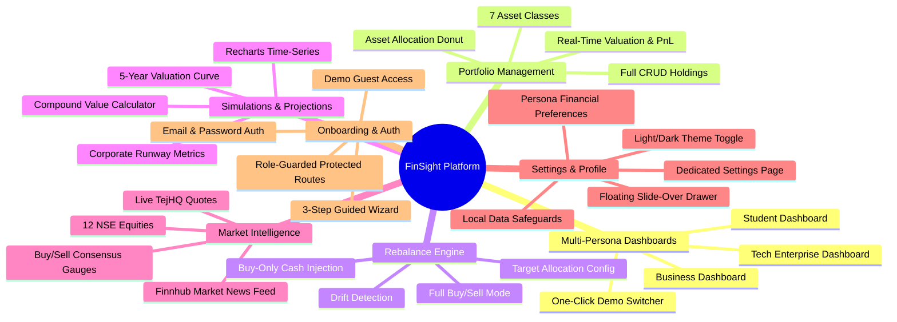

# FinSight — Comprehensive Project Summary

> **Project:** FinSight — Personal & Business Financial Intelligence Platform  
> **Repository:** `harmankaur-13/FinSight`  
> **Document:** `summary.md`  
> **Author & Lead Developer:** Harman Kaur & Team  
> **Date:** October 2026

---

## 1. Executive Overview

**FinSight** is a modern, responsive, local-first financial intelligence and portfolio analytics web platform. Designed to bridge the gap between complex enterprise financial software and beginner-friendly budgeting apps, FinSight delivers tailored financial workflows, real-time analytics, portfolio rebalancing mathematics, and live market intelligence through three distinct persona dashboards:

1. **Student Learner (`/student-dashboard`)**: Designed for young adults and students learning personal finance, budgeting, emergency fund planning, and long-term compound growth.
2. **Business Intelligence (`/business-dashboard`)**: Tailored for business owners, finance teams, and corporate treasurers managing working capital, runway health, debt/equity balance, volatility, and Sharpe ratios.
3. **Tech / Enterprise (`/tech-dashboard`)**: Built for executives and tech founders tracking sector exposure, capital budget allocation, risk stress-testing, strategic acquisition simulations, and multi-year valuation projections.

The platform is engineered as a high-performance **React 18 Single-Page Application (SPA)** built with **Vite 5**, styled with custom **CSS3 Design Tokens** supporting native Light/Dark modes, enriched with **Recharts** and custom **SVG visualizations**, and integrated with live market APIs (**Finnhub** and **TejHQ**).

---

## 2. Core Problem & Value Proposition

### The Problem
- **Fragmented Tools:** Modern investors juggle disparate tools: one spreadsheet for portfolio tracking, a separate broker for stock prices, news websites for macro headlines, and manual calculators for rebalancing.
- **One-Size-Fits-None Dashboards:** Most finance software treats a university student with ₹5,000 in monthly savings the same as a corporate treasurer with ₹50,00,000 in working capital.
- **Privacy & Security Concerns:** Cloud-hosted personal finance tools frequently require users to upload sensitive bank credentials and financial logs to third-party databases.
- **Calculation Errors & Portfolio Drift:** Investors fail to rebalance their asset distributions over time because calculating multi-asset drift and tax-efficient buy/sell quantities requires complex math.

### The FinSight Solution
- **Unified Intelligence Hub:** Live market news, NSE stock ratings, multi-asset portfolio CRUD, target allocation drift detection, rebalance trade recommendations, and future compounding simulations in one coherent UI.
- **Adaptive Persona Experience:** Dynamic UI and metric isolation ensuring users only see what is relevant to their financial lifecycle stage.
- **Local-First Privacy Architecture:** All portfolio records, accounts, and financial preferences are securely stored in the user's browser `localStorage`. No sensitive financial records leave the device.
- **Algorithmic Rebalancing Engine:** Automated math engine calculating exact currency amounts to rebalance portfolios via full buy/sell trades or buy-only fresh capital contributions.
- **Resilient Offline Architecture:** If external APIs encounter network failures or rate limits, FinSight gracefully falls back to curated benchmark data, guaranteeing 100% operational uptime.

---

## 3. Features Implemented



### 3.1. Tailored Multi-Persona Dashboards
- **Student Dashboard (`/student-dashboard`):**
  - Monthly savings monitor with quick budget adjustments.
  - Emergency fund milestone progress bar.
  - Custom financial goals with progress indicators.
  - Interactive financial education modules and video explainers.
  - Future value compound simulator slider.
  - Smart contextual financial assistant suggestions.
- **Business Dashboard (`/business-dashboard`):**
  - Working capital health indicators and operational runway estimates.
  - Corporate treasury equity/debt distribution.
  - Advanced risk metrics: Portfolio Beta (`0.94`), Annualized Volatility (`11.2%`), Sharpe Ratio (`1.82`), and Maximum Stress Test Loss.
  - Tabular holdings ledger with absolute profit/loss and percentage returns.
  - Macro market outlook and liquidity recommendations.
- **Tech / Enterprise Dashboard (`/tech-dashboard`):**
  - Sector concentration gauge tracking cloud infrastructure, AI, and enterprise tech exposure.
  - Cost/Loss risk concentration analytics.
  - Strategic Acquisition Simulator (Crunch acquisition stress-test scenario).
  - 5-year valuation trajectory cards (2026 to 2030) with projected compound growth.
  - Executive rebalancing recommendations.
- **Instant Demo Switcher:**
  - One-click navigation toggle allowing users to switch between Student, Business, and Tech personas without re-authenticating.

### 3.2. Portfolio Asset Management & CRUD Engine
- Supported Asset Classes: `Stocks`, `Mutual Funds`, `ETFs`, `Bonds`, `Crypto`, `Real Estate`, and `Other`.
- Full CRUD operations via `ManagePortfolioModal.jsx`:
  - **Add:** Name, asset type, invested capital, current market value, and target allocation percentage.
  - **Edit:** Real-time updates with form validation and error safeguards.
  - **Delete:** Removal with immediate recalculation of all portfolio totals.
- Financial Metrics Derivation:
  - Total Portfolio Valuation ($\sum \text{Current Value}$).
  - Total Invested Capital ($\sum \text{Invested Amount}$).
  - Total Net Profit / Loss ($\text{Valuation} - \text{Invested}$).
  - Performance Percentage ($(\text{PnL} / \text{Invested}) \times 100$).
  - Asset Allocation Percentages per category with automatic sorting by weight.

### 3.3. Algorithmic Portfolio Rebalancing Engine
- Integrated in `src/components/RebalanceEngine.jsx` using `calculateRebalanceTrades()`:
  - **Drift Detection:** Compares current asset weight against target allocations to identify portfolio skew.
  - **Strict Target Validation:** Ensures custom target allocations sum to exactly 100% (with 0.05% tolerance).
  - **Full Rebalance Mode (`allowSell: true`):** Calculates exact buy and sell trades to bring all asset classes into exact equilibrium with target percentages.
  - **Buy-Only Mode (`allowSell: false`):** Ideal for taxable accounts. Allocates fresh cash contributions (`newCash`) strictly to underweight asset classes using a proportional shortfall scaling algorithm without triggering sell orders.
  - **Drift Comparison:** Visually displays Max Drift Before vs Max Drift After rebalancing.

### 3.4. Interactive Financial Visualizations & Simulations
- **Portfolio Performance Chart (`PortfolioChart.jsx`):**
  - Recharts `AreaChart` with gradient fill.
  - Timeframe selector: `1M`, `6M`, `1Y`, and `ALL`.
  - Daily snapshot logging in `valueHistory.js` (capped at 365 daily points).
  - Simulated compound projection curve when fewer than 2 historical points exist.
- **Interactive Asset Allocation Donut (`AllocationDonut.jsx`):**
  - Custom SVG donut chart with mathematical arc calculations.
  - Hover highlights, segment isolation, center total display, and colored legend tags.
- **Future Value Compound Calculator (`FutureSimulation.jsx`):**
  - Configurable initial principal, monthly contribution, time horizon (1–5 years), and expected annual return (5%–20%).
  - Real-time compounding mathematical calculation in Indian Rupee format.

### 3.5. Equity Intelligence & Ratings Engine (`/ratings`)
- Tracks 12 major Indian equities across 6 sectors:
  - `RELIANCE` (Conglomerate), `TCS` (Tech), `INFY` (Tech), `HDFCBANK` (Banking), `ICICIBANK` (Banking), `SBIN` (Banking), `TATAMOTORS` (Auto), `M&M` (Auto), `BHARTIARTL` (Telecom), `ITC` (FMCG), `HINDUNILVR` (FMCG), `LT` (Infrastructure).
- Live market data fetched from the keyless **TejHQ Daily OHLCV NSE endpoint**.
- Features:
  - Strict ticker symbol whitelist validation for security.
  - Safe previous-close price change and percentage calculation.
  - Research consensus gauge (Strong Buy, Buy, Hold).
  - Target price spread and upside potential calculations.
  - Sector filtering buttons, sorting by Rating/Price/Market Cap, and instant keyword search.
  - Resilient offline fallback with clear status badges ("Live NSE Quote" vs "Offline Reference").

### 3.6. Real-Time Market News Feed (`/news`)
- Integrated with the **Finnhub Market News API**.
- Key capabilities:
  - Multi-category normalization: `Markets`, `Business`, `Crypto`, `Technology`, `Stocks`, `Economy`.
  - Human-friendly date formatting from UNIX epoch timestamps (`formatNewsDate`).
  - Automated read-time estimation (~180 words/min).
  - Graceful handling of HTTP 429 (rate limits) and 401/403 (unauthorized).
  - Seamless offline fallback to curated market intelligence.
  - Direct external reading links opening safely in new tabs.

### 3.7. User Profile & Floating Settings System
- **Floating Slide-Over Drawer (`FloatingSettings.jsx`):**
  - Discrete modal accessible from the top navigation gear button or user avatar on any dashboard page.
  - Quick theme toggling, active role switching, and account shortcuts without page navigation.
  - Full keyboard accessibility (`Escape` key close, focus management, click-outside dismissal).
- **Dedicated Full Settings Page (`Settings.jsx`):**
  - **Tab 1: Profile:** Avatar selection (preset list or custom image URL), user name editor with automatic camelCase and surname parsing (`formatHumanName`), email address, and role selector.
  - **Tab 2: Financial Preferences:** Persona-isolated configuration:
    - *Student:* Monthly budget, target savings goal, and milestone checklists.
    - *Business:* Working capital liquidity buffer, reporting currency, and runway targets.
    - *Tech:* Enterprise tech sector interests and risk appetite preference.
  - **Tab 3: Appearance:** Light, Dark, or System mode selection, and accent color palette options.
  - **Tab 4: Notifications:** Preferences for allocation drift alerts, market volatility notices, and security alerts.
  - **Tab 5: Security & Privacy:** Local-first architecture disclosure, session sign-out, and protected "Reset Portfolio Data" with safety confirmation.

### 3.8. Onboarding Wizard & Route Guards
- **Guided 3-Step Onboarding (`/onboarding`):**
  - Step 1: User profile, display name, and persona selection.
  - Step 2: Investment experience level and risk tolerance profile.
  - Step 3: Starting financial balances and initial portfolio seeding.
- **Route Protection Architecture (`ProtectedRoute.jsx` & `AdaptiveLayout.jsx`):**
  - Public routes (`/`, `/login`, `/signup`) redirect authenticated users directly to their dashboard.
  - Protected dashboard routes require authentication and completed onboarding.
  - Role-based guards prevent cross-persona URL tampering.
  - Shared content pages (`/news`, `/ratings`, `/features`, `/about`) dynamically adapt their navigation bar based on authentication state.

---

## 4. Summary of Codebase Changes & Why We Did That

| Milestone & Area | Key Changes Made | Technical Justification ("Why We Did That") |
| :--- | :--- | :--- |
| **Vite & React 18 Migration** | Migrated static HTML into React functional components and initialized Vite 5 build tool. | Eliminates full-page reloads, provides instant HMR (<200ms), and enables declarative state-driven UI updates. |
| **Design System & Theme** | Built `ThemeContext.jsx` and 94KB `index.css` using native CSS variables with Light/Dark modes. | Eliminates heavy CSS framework dependencies (Tailwind), allows instant theme toggling at runtime, and ensures seamless dark mode contrast. |
| **Routing & Layouts** | Implemented `AdaptiveLayout.jsx`, `DashboardLayout.jsx`, and `ProtectedRoute.jsx`. | Ensures public guests and authenticated members receive appropriate navbars without code duplication across pages. |
| **Financial Math Core** | Built pure math functions in `financialCalculations.js` and `RebalanceEngine.jsx`. | Decoupling financial algorithms from React components ensures 100% deterministic unit testing and guarantees mathematical correctness. |
| **Simulations & History** | Implemented `FutureSimulation.jsx` and daily value snapshots in `valueHistory.js`. | Allows users to visualize the real-world power of compounding and tracks daily equity changes over 1M/6M/1Y timeframes. |
| **Finnhub News Service** | Created `services/newsApi.js` with category normalization and error handling. | Replaced static mock text with real-time global financial news while adding fallback circuits for offline reliability. |
| **TejHQ Stock API** | Created `services/ratingsApi.js` with symbol whitelist validation and INR currency formatting. | Provides live daily market prices for 12 top Indian equities without requiring paid backend subscriptions. |
| **Floating Settings & Profile** | Added `FloatingSettings.jsx`, `/settings` page, and `formatHumanName()` helper. | Gives users instant access to profile settings without interrupting dashboard analysis, and formats human names cleanly from raw email addresses. |
| **Automated Testing** | Developed 8 test suites with 132 unit and integration tests in Vitest. | Verifies all mathematical calculations, API fallback circuits, route guards, and UI components with sub-second execution (886ms). |

---

## 5. Technology Stack Summary

```text
Frontend Framework:     React 18.3.1 (Hooks, Context, Memoization)
Build System:           Vite 5.4.3 (ESM, Fast HMR, Rollup Bundler)
Routing Engine:         React Router DOM 6.26.2 (Nested Routes, Protected Guards)
Styling Architecture:   Vanilla CSS3 Design Tokens (Light/Dark Themes, Glassmorphism)
Charting & Visuals:     Recharts 3.10.1 & Custom SVG Donut Charts
State & Persistence:    React Context (ThemeContext) + Custom Hook (useFinanceData) + LocalStorage
External APIs:          Finnhub Market News API & TejHQ Daily OHLCV NSE Quotes API
Testing Framework:      Vitest 2.1.9 (132 Tests, 8 Suites, 100% Passing)
```

---

## 6. Verification & Quality Assurance

FinSight has been thoroughly validated across multiple testing dimensions:
- **Unit & Mathematical Testing:** `financialCalculations.test.mjs` validates 33 distinct mathematical edge cases including division by zero, rounding precision, and buy-only cash scaling.
- **API & Mock Testing:** `newsApi.test.js` and `ratingsApi.test.js` validate HTTP error statuses (429, 401, 500), malformed payloads, rate limits, and ticker whitelists.
- **Component & Integration Testing:** `Settings.test.jsx`, `Ratings.test.jsx`, `FloatingSettings.test.jsx`, and `ProtectedRoute.test.jsx` verify user interactions, tab switching, and route protection.
- **Production Build:** Verified with `npm run build` producing optimized, tree-shaken static assets ready for deployment.
