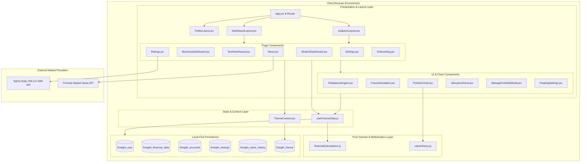
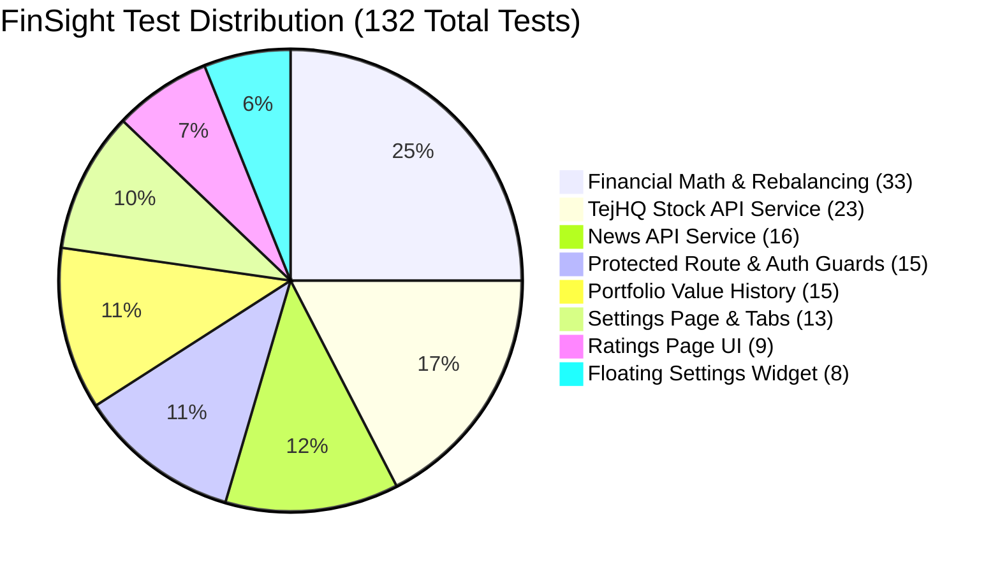

# FinSight — System Design & Architecture Specification

> **Project:** FinSight — Personal & Business Financial Intelligence Platform  
> **Repository:** `harmankaur-13/FinSight`  
> **Document:** `system.md`  
> **Author & Lead Developer:** Harman Kaur & Team  
> **Date:** October 2026

---

## 1. System Architecture Overview

FinSight is engineered as a **local-first, privacy-centric, client-rendered Single-Page Application (SPA)**. It combines modern functional React patterns with deterministic mathematical utilities, responsive CSS design tokens, and resilient external API integrations.



---

## 2. Core Architectural Principles

1. **Local-First Privacy Architecture:**
   Financial tracking data is inherently sensitive. FinSight stores all portfolio holdings, investment values, custom financial goals, and personal settings entirely within browser `localStorage`. No user financial balances are ever transmitted to a central backend database.
2. **Deterministic Mathematical Core:**
   All financial formulas (portfolio market valuation, net return percentages, asset allocation weights, drift metrics, and buy/sell rebalancing trade generation) are implemented as pure, stateless JavaScript functions. They are completely decoupled from UI components, guaranteeing 100% test reproducibility and zero side effects.
3. **Resilient Offline Circuit Breakers (Graceful Degradation):**
   External network services (Finnhub for news, TejHQ for stock prices) are wrapped in try/catch circuit breakers. If an API rate limit is reached, network connectivity drops, or an API key is missing, the application automatically falls back to curated sample benchmarks without throwing unhandled exceptions or disrupting user interactions.
4. **Multi-Persona Polymorphism:**
   The application derives three distinct persona perspectives (Student, Business Treasury, Big Tech) from a single shared portfolio data model. Contextual metrics, risk ratios, and dashboard projections adapt automatically based on the user's active persona.
5. **Zero-Dependency Styling System:**
   Rather than relying on third-party CSS utilities (e.g., Tailwind or Emotion) that introduce build overhead and CSS runtime bloat, FinSight employs a 94KB native CSS3 design system built on CSS Custom Properties (`--bg`, `--surface`, `--text`, `--green`, `--card-shadow`), enabling instant, flicker-free Light and Dark mode transitions.

---

## 3. Component Hierarchy & Tree Structure

```text
src/
├── main.jsx (React Root Entry)
└── ThemeProvider (ThemeContext.jsx)
    └── App.jsx (Top-Level Controller & Routing)
        ├── ScrollToTop (Scroll Coordinator)
        ├── BrowserRouter
        │   └── Routes
        │       ├── PublicLayout (Marketing Shell: Navbar + Footer)
        │       │   └── Landing.jsx (Hero, Persona Selector, Value Props)
        │       │
        │       ├── AdaptiveLayout (Swaps Navbar/Footer based on Auth state)
        │       │   ├── Features.jsx (Platform Feature Matrix)
        │       │   ├── News.jsx (Finnhub Live News Feed + Category Filter)
        │       │   │   └── NewsCard.jsx
        │       │   ├── Ratings.jsx (TejHQ Live NSE Quotes + Stock Intelligence)
        │       │   │   └── RatingCard.jsx
        │       │   ├── About.jsx (Company & Engineering Overview)
        │       │   └── NotFound.jsx (404 Fallback)
        │       │
        │       ├── Login.jsx (Auth Form + Demo Access)
        │       ├── Signup.jsx (Account Registration)
        │       │
        │       ├── ProtectedRoute (requireOnboardingCompleted = false)
        │       │   └── Onboarding.jsx (3-Step Guided Setup Wizard)
        │       │
        │       └── ProtectedRoute (requireOnboardingCompleted = true)
        │           └── DashboardLayout (Authenticated Shell)
        │               ├── DashboardNav.jsx (Nav Links, Role Switcher, Floating Trigger)
        │               ├── FloatingSettings.jsx (Slide-Over Settings Overlay)
        │               ├── ManagePortfolioModal.jsx (Holdings & Goals CRUD)
        │               │
        │               ├── StudentDashboard.jsx (Student Persona View)
        │               │   ├── PortfolioCard.jsx
        │               │   ├── AllocationDonut.jsx (Custom SVG Donut)
        │               │   ├── FutureSimulation.jsx (Compound Calculator)
        │               │   ├── EducationCard.jsx (Tutorial Modules)
        │               │   └── AssistantCard.jsx (Contextual Financial Advice)
        │               │
        │               ├── BusinessDashboard.jsx (Corporate Treasury View)
        │               │   ├── HoldingsTable.jsx (Equities & Debt Ledger)
        │               │   ├── AllocationCard.jsx
        │               │   ├── RebalanceEngine.jsx (Algorithmic Trade Rebalancer)
        │               │   └── ProjectionCard.jsx (Treasury Runway)
        │               │
        │               ├── TechDashboard.jsx (Enterprise View)
        │               │   ├── PortfolioChart.jsx (Recharts Time-Series)
        │               │   ├── RebalanceEngine.jsx
        │               │   ├── HoldingsTable.jsx
        │               │   └── ProjectionCard.jsx (5-Year Strategic Curves)
        │               │
        │               └── Settings.jsx (Dedicated Full-Page Configuration)
```

---

## 4. Data Models & Schema Specifications

### 4.1. User Session Model (`finsight_user`)
```typescript
interface UserSession {
  name: string;               // Clean formatted user name (e.g. "Harman Kaur")
  email: string;              // Primary identifier (e.g. "user@example.com")
  userType: 'student' | 'business' | 'tech'; // Active persona
  investments: string[];      // High-level asset category strings
  goals: string[];            // Selected milestone strings
  isLoggedIn: boolean;        // Active authentication session flag
  isDemo: boolean;            // True if running under mock demo account
  needsOnboarding: boolean;   // True if onboarding wizard must be completed
  avatar?: string;            // Avatar preset name or custom image URL
}
```

### 4.2. Investment Holding Model (`finsight_financial_data[email].investments`)
```typescript
interface InvestmentHolding {
  id: string;                 // Unique identifier (e.g. "inv-17298512-abcde")
  name: string;               // Asset name (e.g. "Tata Consultancy Services")
  type: 'Stocks' | 'Mutual Funds' | 'ETFs' | 'Bonds' | 'Crypto' | 'Real Estate' | 'Other';
  investedAmount: number;     // Principal capital invested in ₹
  currentValue: number;       // Current market valuation in ₹
  targetAllocation: number | null; // Desired target portfolio weight (0–100%)
}
```

### 4.3. Financial Goal Model (`finsight_financial_data[email].goals`)
```typescript
interface FinancialGoal {
  id: string;                 // Unique goal identifier (e.g. "goal-172985-fghij")
  title: string;              // Goal description (e.g. "Emergency Fund Milestone")
  current: number;            // Current accumulated amount in ₹
  target: number;             // Target objective in ₹
  unit: string;               // Currency or unit symbol (default: "₹")
}
```

### 4.4. User Settings Model (`finsight_settings_{email}`)
```typescript
interface UserSettings {
  currency: 'INR' | 'USD' | 'EUR';
  dateFormat: 'DD/MM/YYYY' | 'MM/DD/YYYY';
  notifications: {
    marketAlerts: boolean;
    allocationDrift: boolean;
    digestEmail: boolean;
    securityAlerts: boolean;
  };
  student: {
    financialGoals: string[];
    monthlyBudget: number;
    savingsGoal: number;
  };
  business: {
    businessGoals: string[];
    reportingCurrency: string;
  };
  tech: {
    investmentFocus: string;
    sectorInterests: string[];
    riskPreference: string;
  };
}
```

### 4.5. Normalized Stock Quote Model
```typescript
interface StockQuote {
  symbol: string;             // NSE ticker (e.g. "INFY")
  date: string;               // ISO date string (YYYY-MM-DD)
  price: number;              // Current closing price in ₹
  previousClose: number | null; // Previous trading day closing price
  change: number | null;      // Absolute price change in ₹
  changePercent: number | null;// Percentage price change (+/- %)
}
```

### 4.6. Normalized News Article Model
```typescript
interface NewsArticle {
  id: string | number;        // Unique article ID
  category: string;           // 'Markets' | 'Business' | 'Crypto' | 'Technology' | 'Economy'
  headline: string;           // News headline title
  summary: string;            // Brief article synopsis
  source: string;             // Publisher attribution (e.g. "Bloomberg", "Reuters")
  date: string;               // Human formatted date (e.g. "Oct 25, 2026")
  readTime: string;           // Estimated read duration (e.g. "3 min read")
  url: string;                // External link to original article
}
```

---

## 5. Mathematical & Algorithmic Core

All mathematical calculations are implemented in `src/utils/financialCalculations.js`.

### 5.1. Portfolio Valuation & Absolute Profit/Loss
Let $I = \{inv_1, inv_2, \dots, inv_n\}$ be the set of holdings.
- **Current Portfolio Value ($V$):**
  $$V = \sum_{i \in I} \text{currentValue}_i \quad (\text{falling back to } \text{investedAmount}_i \text{ if missing})$$
- **Total Invested Capital ($C$):**
  $$C = \sum_{i \in I} \text{investedAmount}_i$$
- **Absolute Profit / Loss ($P$):**
  $$P = V - C$$
- **Percentage Return ($R$):**
  $$R = \begin{cases} 0\% & \text{if } C = 0 \\ \left(\frac{P}{C}\right) \times 100 & \text{if } C > 0 \end{cases}$$

---

### 5.2. Asset Allocation & Drift Detection
Let $A$ be the set of distinct asset classes. For each asset class $a \in A$:
- **Asset Class Value ($V_a$):**
  $$V_a = \sum_{i \in I, \text{type}_i = a} \text{currentValue}_i$$
- **Actual Weight ($w_a$):**
  $$w_a = \left(\frac{V_a}{V}\right) \times 100$$
- **Portfolio Allocation Drift ($D$):**
  $$D = \max_{a \in A} |w_a - T_a|$$
  where $T_a$ is the configured target percentage for asset class $a$. If $D > 5.0\%$, FinSight triggers an automated rebalance advisory alert.

---

### 5.3. Algorithmic Portfolio Rebalancing (`calculateRebalanceTrades`)

The rebalancer supports two distinct modes:

#### Mode 1: Full Rebalance (`allowSell = true`)
Calculates exact capital reallocations across all asset classes, selling overweight positions to buy underweight positions.
1. Total Post-Rebalance Value: $V_{\text{post}} = V + \text{newCash}$
2. For each asset class $a$:
   $$\text{Target Value}_a = V_{\text{post}} \times \left(\frac{T_a}{100}\right)$$
   $$\Delta_a = \text{Target Value}_a - V_a$$
3. Trade Generation:
   - If $\Delta_a > 0.5$: Generate `BUY` trade of amount $\text{round}(\Delta_a)$
   - If $\Delta_a < -0.5$: Generate `SELL` trade of amount $\text{round}(|\Delta_a|)$

#### Mode 2: Buy-Only Cash-Injection (`allowSell = false`)
Prohibits selling assets to prevent capital gains taxes. Uses fresh cash ($\text{newCash}$) to buy underweight assets proportionally.
1. Target portfolio value after cash injection: $V_{\text{target}} = V + \text{newCash}$
2. For each asset class $a$:
   $$\text{Shortfall}_a = \max\left(0, \left[V_{\text{target}} \times \frac{T_a}{100}\right] - V_a\right)$$
3. Total Shortfall: $S_{\text{total}} = \sum_a \text{Shortfall}_a$
4. Proportional Scaling:
   $$\text{Scale} = \begin{cases} 0 & \text{if } S_{\text{total}} = 0 \\ \min\left(1, \frac{\text{newCash}}{S_{\text{total}}}\right) & \text{if } S_{\text{total}} > 0 \end{cases}$$
5. Planned Buy Amount for asset $a$:
   $$\text{Buy}_a = \text{round}(\text{Shortfall}_a \times \text{Scale})$$
6. A rounding reconciliation step adjusts buy orders to guarantee that $\sum_a \text{Buy}_a \le \text{newCash}$.

---

### 5.4. Future Value Compound Interest Simulation
Implemented in `src/components/FutureSimulation.jsx`:
$$A = P \left(1 + \frac{r}{12}\right)^{12t} + \text{PMT} \times \left[\frac{\left(1 + \frac{r}{12}\right)^{12t} - 1}{\frac{r}{12}}\right]$$
Where:
- $P$ = Initial starting principal in ₹
- $\text{PMT}$ = Monthly contribution in ₹
- $r$ = Annual nominal interest rate (decimal, e.g. 0.12 for 12%)
- $t$ = Time horizon in years (1 to 5 years)
- $A$ = Total accumulated future value

---

## 6. External Service Integration & Security Architecture

### 6.1. TejHQ Daily NSE Stock Quotes API
- **Endpoint:** `https://api.tejhq.dev/v1/ohlcv/nse/{SYMBOL}`
- **Security Whitelist Enforcement:**
  Before initiating any network request, symbols are validated against `SUPPORTED_SYMBOLS`:
  ```javascript
  export const SUPPORTED_SYMBOLS = Object.freeze([
    'INFY', 'HDFCBANK', 'RELIANCE', 'TCS', 'LT', 'TITAN',
    'SBIN', 'ICICIBANK', 'BHARTIARTL', 'ITC', 'M&M', 'SUNPHARMA'
  ]);
  ```
- **URL Encoding:** Symbols containing special characters (e.g. `M&M`) are passed through `encodeURIComponent()` to avoid malformed URL queries.
- **Normalization:** Automatically sorts rows by date timestamp to guarantee that the true latest closing price is extracted, calculating daily variance against `prev_close`.

### 6.2. Finnhub Market News API
- **Endpoint:** `https://finnhub.io/api/v1/news`
- **Authentication:** `VITE_FINNHUB_API_KEY` loaded via Vite's `import.meta.env`.
- **Query Parameter Building:** Uses standard browser `URLSearchParams`.
- **Rate Limit & Error Interception:** Explicitly inspects `response.status`:
  - `429`: Intercepts rate limiting (60 calls/minute limit) and surfaces a helpful cooldown notice.
  - `401/403`: Flags API key configuration issues.
  - Network Failure: Automatically redirects data pipeline to `NEWS_DATA` fallback.

### 6.3. Security & Vulnerability Analysis
- **Zero Server-Side Attack Surface:** Because FinSight runs 100% client-side with no custom backend API or SQL database, common server vulnerabilities (SQL injection, remote code execution, server-side request forgery) are eliminated.
- **XSS Mitigation:** React JSX automatically escapes dynamic values before rendering them to the DOM.
- **External Links:** All external news and research links use `target="_blank"` with `rel="noopener noreferrer"` to prevent window opener hijacking.
- **Storage Safeguards:** The Settings page includes an explicit confirmation step ("Reset Portfolio Data") to prevent accidental deletion of local records.

---

## 7. Performance & Optimization Strategy

1. **Tree-Shaking & Dead Code Elimination:** Vite 5 and Rollup analyze ES Module import graphs to discard unused export paths during production builds.
2. **Component Memoization (`useMemo` & `useCallback`):**
   - Expensive portfolio valuation and drift calculations in `useFinanceData.js` are wrapped in `useMemo`, executing only when `financialData` or `user` identity changes.
   - Event handlers passed to child components (`addInvestment`, `deleteGoal`, `updateProfile`) are stabilized using `useCallback`.
3. **Optimized SVG Render Loops:**
   - The `AllocationDonut.jsx` chart uses native SVG `<circle>` elements with pre-computed `strokeDasharray` and `strokeDashoffset` math, avoiding heavyweight canvas redraw cycles.
4. **CSS Token Cascade:** Theme toggling does not cause full React component tree re-renders; changing `data-theme` on `<html>` instantly repaints color variables natively in the browser graphics pipeline.

---

## 8. Testing Architecture & Verification Matrix

FinSight utilizes **Vitest** for fast, native ES Module unit and component testing.



### Test Suites Breakdown:
1. `src/utils/financialCalculations.test.mjs` (33 tests): Validates portfolio valuation, profit/loss math, drift detection, buy/sell trade generation, buy-only cash scaling, and division-by-zero guards.
2. `src/services/ratingsApi.test.js` (23 tests): Validates symbol whitelist, currency formatting, JSON row normalization, network errors, and date-sorting extraction.
3. `src/services/newsApi.test.js` (16 tests): Validates category normalization, date formatting, read-time word counts, HTTP 429/401 handling, and offline fallback.
4. `src/components/ProtectedRoute.test.jsx` (15 tests): Tests unauthenticated redirection, onboarding interception, and role-based access gating.
5. `src/utils/valueHistory.test.js` (15 tests): Tests daily snapshot deduplication, 365-day cap, 1M/6M/1Y timeframe filtering, and projected curve generation.
6. `src/pages/Settings/Settings.test.jsx` (13 tests): Tests 5-tab switching, persona preference isolation, theme toggling, and data reset safeguards.
7. `src/pages/Ratings/Ratings.test.jsx` (9 tests): Tests live vs offline quote rendering, sector filtering, and search filtering.
8. `src/components/FloatingSettings.test.jsx` (8 tests): Tests slide-over drawer toggling, focus trapping, Escape key closing, and outside click detection.

---

## 9. Build & Deployment Architecture

```bash
# Development Mode (Vite HMR Server)
npm run dev

# Automated Test Suite (Vitest)
npm run test

# Production Optimization Bundle (Rollup Tree-Shaking)
npm run build

# Preview Production Build Locally
npm run preview
```

### Static Asset Hosting Compatibility:
Because FinSight produces a static bundle (`index.html`, `/assets/*.js`, `/assets/*.css`, `/favicons/`, `/images/`), it can be deployed with zero infrastructure overhead on any modern CDN or static host:
- Vercel
- Netlify
- GitHub Pages
- Cloudflare Pages
- AWS S3 + CloudFront
